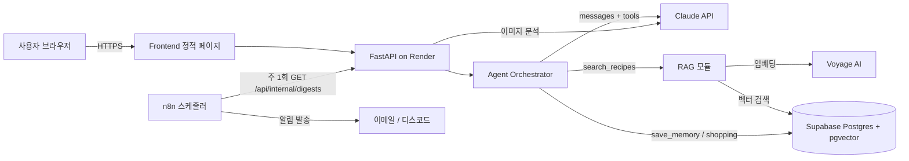

# 기능 요구 명세서

## 1. 개요
- 프로젝트명: FridgeMate
- 목적: 냉장고 재료 기반 개인화 요리 추천과 장보기 자동화
- 대상: 1인 가구, 자취생, 직장인

## 2. 기능 요구사항
| ID | 기능명 | 설명 | 우선순위 |
|----|--------|------|----------|
| FR-01 | 회원 등록 및 동의 | 닉네임 입력, 개인정보 수집 동의 체크 후 사용 시작 | Must |
| FR-02 | 냉장고 사진 분석 | 이미지 업로드 시 재료 목록 추출 (멀티모달) | Must |
| FR-03 | 재료 목록 확인, 수정 | 인식 결과를 사용자가 수정한 뒤 확정 | Must |
| FR-04 | 레시피 추천 (RAG) | 재료, 시간 조건으로 레시피 DB 검색 후 근거 기반 답변 | Must |
| FR-05 | 개인 기억 | 알레르기, 비선호, 조리 수준을 대화에서 추출해 저장, 이후 자동 반영 | Must |
| FR-06 | Agent 대화 | 자연어 요청을 해석해 도구(검색, 저장, 장보기)를 자율 호출 | Must |
| FR-07 | 장보기 목록 | 부족 재료를 목록에 저장하고 조회 | Should |
| FR-08 | 주간 알림 | n8n이 주 1회 개인화 메시지를 발송 | Should |
| FR-09 | 만족도 피드백 | 답변별 👍/👎, 코멘트 저장 | Must |
| FR-10 | 데이터 삭제 | 사용자가 본인 데이터 전체 삭제 요청 | Must |
| FR-11 | 기억 조회 | 저장된 "내 정보"를 화면에서 확인 | Could |

## 3. 비기능 요구사항
| ID | 항목 | 요구사항 |
|----|------|----------|
| NFR-01 | 응답 속도 | 텍스트 응답 평균 8초 이내 (Agent 다단계 호출 포함) |
| NFR-02 | 가용성 | 테스트 기간 중 95% 이상 |
| NFR-03 | 개인정보 | 최소 수집(닉네임, 선택적 이메일), 전송 구간 HTTPS, 서버 키는 환경변수로만 관리 |
| NFR-04 | 이미지 | 업로드 이미지는 **저장하지 않고** 분석 후 폐기, 5MB 제한 |
| NFR-05 | 비용 통제 | 사용자당 일 30회 호출 제한 |
| NFR-06 | AI 윤리 | 모든 AI 응답 화면에 "AI 생성 콘텐츠" 명시 |
| NFR-07 | 안전 | 알레르기 정보는 추천에서 강제 제외, 확인 안내 문구 표시 |
| NFR-08 | 사용성 | 모바일 브라우저에서 카메라 촬영 업로드 가능 |

## 4. AI 활용 명세
| 기능 | AI 방식 | 상세 |
|------|---------|------|
| 재료 인식 | Vision LLM | 이미지 → JSON(재료명, 추정 수량, 신뢰도) |
| 레시피 추천 | RAG + LLM | 질의 임베딩 → pgvector 상위 k 검색 → 검색 결과만 근거로 답변 |
| 개인화 | Long-term Memory | 대화에서 선호 추출 → DB 저장 → 시스템 프롬프트에 주입 |
| 대화 제어 | Tool-use Agent | search_recipes, save_memory, add_to_shopping_list |
| 주간 알림 | n8n + LLM | 장보기 목록, 선호 기반 개인화 메시지 생성 |

## 5. 시스템 아키텍처

## 6. 데이터 모델 (ERD 요약)
- users(id, nickname, notify_email, consent_at, created_at)
- recipes(id, title, ingredients[], steps, time_min, difficulty, embedding)
- memories(id, user_id, kind, content, created_at)
- messages(id, user_id, role, content, created_at)
- shopping_items(id, user_id, item, done, created_at)
- feedback(id, user_id, message_id, rating, comment, created_at)

## 7. 주요 시퀀스: 레시피 추천
1. 사용자가 사진 업로드 → `/api/fridge` → 재료 JSON 반환
2. 사용자가 재료를 수정, 확정 후 "20분 내로 만들 수 있는 거 추천해줘" 입력
3. `/api/chat` → 서버가 Memory(알레르기 등)를 시스템 프롬프트에 주입
4. Claude가 `search_recipes` 도구를 호출 → pgvector 검색 결과 반환
5. Claude가 검색 결과만 근거로 답변, 부족 재료는 `add_to_shopping_list` 호출
6. 선호가 새로 드러나면 `save_memory` 호출
7. 응답 + "AI 생성" 표시를 사용자에게 전달
